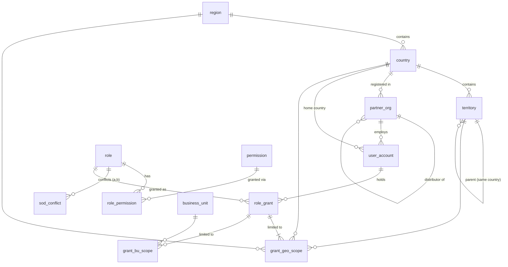

# identity-access-service: database schema (`gc_iam`, schema `iam`)

Extracted from the platform schema analysis (growercare `docs/backend/01_RDS_SCHEMA.md`) when the service got its own repository (ADR-017). Keep this file in step with migrations (PR policy R25).

## Roles: Databases, schemas and roles

| Database | Owner service | Schemas | Shape |
|---|---|---|---|
| `gc_iam` | identity-access-service | `iam` | Single schema (low volume: users, grants) |
| `gc_case` | case-service | `ref` + `in_s00…in_s63`, `br_s00…br_s63` | 64 logical shards per country. One schema per shard, built from one migration template |

**Two login roles per database** (`local-dev/postgres/01-init.sh`, mirrored in tests by `PostgresTestDatabase`):

| Role | Used by | Rights |
|---|---|---|
| `<db>_owner` | Flyway only (pre-deploy job in prod, startup locally) | Owns all objects, so it is the only role that can run DDL |
| `<db>_app` | The running service | Reads and writes rows only. It has no DDL rights, can only read `ref.*`, cannot delete or truncate case history, and can only append to `iam.audit_event` |

Tests check these rights explicitly (`LeastPrivilege`, `auditTrailIsAppendOnlyForTheRuntimeRole`). If the service is compromised, it still cannot change the schema or rewrite history.

**A third, cluster-wide role: `gc_cdc`** (SPEC-PLAT-04 D8; `local-dev/postgres/02-cdc-role.sh`, mirrored by `PostgresTestDatabase.CDC_ROLE`). This is Debezium's login. It has `REPLICATION` plus `CONNECT` on both databases. The migrations (placeholder `cdc_role`) grant it:
- `SELECT` on the outbox tables;
- write access to the single-row `cdc_heartbeat` table.

It can read nothing else. `OutboxPublicationIT` / `IamOutboxPublicationIT` check that.

---

## 3. `gc_iam` · schema `iam`

| Table | Key | Functional dependencies / notes |
|---|---|---|
| `region` | `region_code` | → name |
| `country` | `country_code` | → region, name, `country_ix`, `case_no_cc`, tz, currency, locale, active. `country_ix` and `case_no_cc` are alternate keys (UNIQUE) because IDs encode them (ID-5) |
| `territory` | `territory_id` (alt: `country_code, territory_code`) | Self-referencing hierarchy STATE > DISTRICT > SALES_AREA. The composite FK `(parent_territory_id, country_code)` keeps a parent in the same country |
| `business_unit` | `bu_code` | → name |
| `permission` | `permission_code` (`resource:action`) | Atomic capability, e.g. `case:transition` |
| `role` | `role_code` | → `role_level` (delegation ceiling, ACC-2), `scope_kind` (how far over data), `allowed_user_type`, `pii_clearance` (ACC-3), `privileged` (ACC-9) |
| `role_permission` | (`role_code`, `permission_code`) | Pure M:N; replaces a `permissions text[]` column |
| `sod_conflict` | (`role_code_a`, `role_code_b`), with `a < b` | Each unordered pair is stored once (ACC-6) |
| `partner_org` | `partner_org_id` (alt: `country_code, tax_id`) | A distributor must be top level (CHECK) |
| `user_account` | `user_id` (alt: `external_subject` = Keycloak `sub`) | No credentials are stored here. Phone = keyed HMAC + last 4 digits, partial UNIQUE. CHECK: a `PARTNER` user ⇔ has `partner_org_id` |
| `role_grant` | `grant_id` | ACC-1: a grant = role + validity + who granted it and why. Revocation is a recorded event, never a DELETE. CHECKs: no self-grant, `valid_to > valid_from`, revocation fields all set together or all empty |
| `grant_geo_scope` | `grant_geo_scope_id` (alt: UNIQUE NULLS NOT DISTINCT) | Exactly one of region / country / territory (`num_nonnulls = 1`). Each has a real FK. This is better than one polymorphic `(level, code)` column that couldn't have FKs |
| `grant_bu_scope` | (`grant_id`, `bu_code`) | No rows means all BUs. This convention is documented and used by `policy-sdk` |
| `audit_event` | `audit_id` | Append-only (UPDATE/DELETE revoked). No FKs on purpose: audit rows must outlive the rows they describe |
| `outbox` | `event_id` | Same-transaction event store (ADR-012) |

**Rules the database can't express**, enforced in the grant service (increment 2) and tested:
- delegation ceiling (ACC-2);
- SoD across active grants (ACC-6);
- "at least one geo scope per grant";
- a grower's grant scope equals their home country.

---

## Event publishing (SPEC-PLAT-04, V5)
- Publication `gc_outbox` = `iam.outbox` + `iam.cdc_heartbeat`, insert/update only; role `${cdc_role}` reads the outbox and upserts the heartbeat.
- V6: permission `case:attach` granted to every role with public/partner comment rights (SPEC-CASE-05 D8).
- V7: permissions `grower:create`, `grower:read`, `grower:update` for growers, retailers (create/read), field staff and care agents (SPEC-GRW-01 D7).
- V8: permission `grower:consent` (OTP verification and consent, assisted onboarding) for growers, retailers, field staff and care agents (SPEC-GRW-03 D7).
- V9: `country.calling_code` (IN 91, BR 55) and the phone check relaxed to "an HMAC needs its last 4", so self-registered growers carry only the last 4 digits (SPEC-IAM-03).
- V10: `user_account_name_ix (lower(display_name) text_pattern_ops)` for the admin user directory's name search (SPEC-IAM-02).
